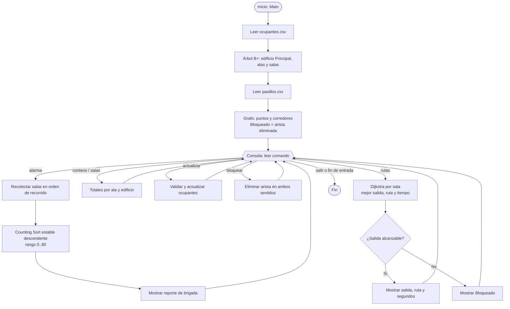
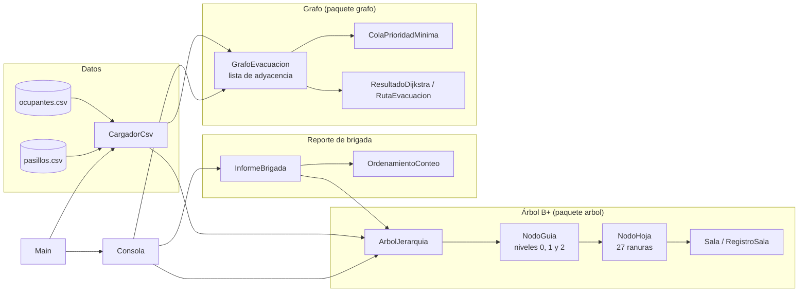
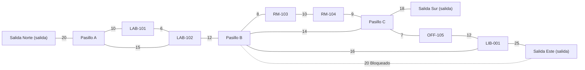

# SalidaSegura

**Proyecto de examen:** Examen 2 – Algoritmos y Estructuras de Datos I (CE1103), sistema de emergencia universitaria «SalidaSegura».
**Autores:** Francisco Ramirez Delgado (@franramidel) y Jan Carlo Vargas Araya (@jan-carlo-vargas)

## 1. Requisitos originales (texto íntegro, sin ediciones)

````text
Implement the university emergency system “SalidaSegura” in the existing repository. Use Java 17 or later. Treat every requirement below as fixed: do not propose alternatives, redesign, omit, weaken, or change requirements, even if another approach seems better. Do not add unrequested features.

Before coding, inspect the repository and the CSV files in `datos/`. Use the CSVs as the data examples and source of truth for their actual schema; do not assume or replace their format. Do not use any other exam context beyond these requirements and the supplied data. If a necessary detail is genuinely ambiguous, choose the smallest deterministic interpretation consistent with these requirements and document it without changing them.

## 1. B+ tree — institutional hierarchy

Implement the hierarchy as one B+ tree with exactly four logical levels:
- Level 0: a single root node linking the institution’s hierarchy.
- Level 1: guide nodes identifying buildings.
- Level 2: guide nodes identifying each building’s wings.
- Level 3: leaf nodes containing a fixed-capacity array of 27 room slots for each wing.

Implement the tree and its node, guide, and leaf structures yourself. Use arrays, custom classes, primitive types, and `String`; do not use Java collection classes. The 27 room slots represent the Spanish alphabet: A through Z, including Ñ in its Spanish alphabetical position. Each room stores its letter/code and integer occupant count. Support buildings and wings represented by the supplied data while preserving this four-level structure.

Provide these operations:
1. Return the room array associated with a given wing.
2. Update the occupants of a specified room.
3. Return the total occupants of a wing or building subtree.

Show the requested counts by wing and building. Handle missing buildings, wings, and rooms, invalid occupant values, and other invalid inputs explicitly; do not silently ignore errors.

## 2. Simulated alarm and brigade report

There is no physical alarm device. Provide a console command/input that simulates receiving the alarm signal. Each time it is received, gather all university rooms and display them in descending order of occupant count using a self-implemented Counting Sort.

The sort must be stable: rooms with equal occupant counts retain their original deterministic input order, preserving each wing array’s Spanish alphabetical order. Define and use a deterministic traversal order for buildings and wings, based on the supplied data. Do not add a different tie-break rule.

The exam data includes a brigade report of 400 rooms and a maximum of 80 occupants per room. The report must finish in less than one second in the worst case, not merely on average. Use the bounded occupant range to implement Counting Sort with linear-time behavior; do not substitute a comparison sort. Include a focused performance check for the specified workload and explain the worst-case time and space costs. Do not claim a hardware-independent timing guarantee that the implementation cannot demonstrate.

## 3. Evacuation graph and route guidance

Implement a self-contained, undirected, weighted, sparse graph for relevant points in a building, including rooms, corridors, and exits. Edge weights are walking time in seconds. Make the model expandable for the supplied CSV data and future buildings, points, and exits.

Implement the graph as an adjacency list and implement its priority queue yourself using arrays/custom classes. Do not use graph, shortest-path, or priority-queue libraries. Use Dijkstra’s algorithm to identify, for every room, the fastest route to any available exit: three exits in the supplied scenario, with support for N exits. Display the selected exit, route, and total walking time for each of the six sample rooms.

Support blocked corridors by removing the corresponding edge before running Dijkstra. Because the graph is undirected, remove the edge in both adjacency directions. A route must never include a blocked edge. If no exit is reachable from a room, report that explicitly as “Bloqueado” (or an equally clear Spanish message); do not return a fabricated route.

## Fixed implementation constraints

- Use Java 17+ only.
- Implement all required data structures and algorithms from scratch.
- Allowed for implementation: arrays, primitive types, custom classes, and `String`.
- Do not use Java collections, including `ArrayList`, `LinkedList`, `HashMap`, `HashSet`, `TreeMap`, `TreeSet`, `PriorityQueue`, `Stack`, or `ArrayDeque`.
- Do not use `Arrays.sort`, `Collections.sort`, `List.sort`, or stream `sorted()`.
- Do not use third-party graph, pathfinding, sorting, or collection libraries.
- Use only the core JDK as needed for console and CSV file I/O, plus JUnit for tests; add no other dependencies.
- Keep the tree and graph structures expandable/modifiable without changing their required logical behavior.
- Keep all user-facing output and README content in Spanish unless the repository’s existing conventions require otherwise.
- Do not suggest improvements or alter the design or requirements.

## Required workflow and deliverables

Use TDD: first write focused tests that fail for the missing behavior, then implement the smallest complete solution, and rerun the tests. Test every functional requirement, including exact expected results, edge cases, ties/stability, blocked and unreachable routes, invalid inputs, CSV loading, and the specified 400-room/80-occupant workload. Ensure any timing checks are reproducible and do not rely only on average-case performance.

Deliver working source code, unit tests, `README.md`, and `PROMPTS.md` at the repository root. The README must include:
- The exam-project name and authors.
- The complete original requirements verbatim, without edits.
- Installation, execution, and test instructions.
- The folder/module/class hierarchy.
- Which requirements were implemented or excluded and why.
- Mermaid diagrams for program flow, components, and the graph.

Append this entire prompt verbatim to `PROMPTS.md` in its chronological position and identify the tool used as “Sonnet 5.5”. Preserve existing prompt-log entries and do not rewrite earlier entries. Do not change any locked requirements while implementing.
````

## 2. Instalación, ejecución y pruebas

Requisitos: JDK 17 o superior y Maven 3.9+. Las pruebas usan JUnit 5 (dependencia de prueba declarada en `java/pom.xml`); el código de la solución no usa ninguna otra dependencia.

```bash
cd java
mvn compile                                     # compilar
java -cp target/classes cr.ac.tec.examen2.Main  # ejecutar (lee ../datos/version-b)
mvn test                                        # pruebas
```

Para usar otra carpeta de datos: `java -cp target/classes cr.ac.tec.examen2.Main <carpeta con ocupantes.csv y pasillos.csv>`.

Comandos de la consola (los argumentos se separan con `;`, porque los nombres pueden llevar espacios):

| Comando | Efecto |
|---|---|
| `alarma` | Simula la señal de alarma: muestra todas las salas de mayor a menor ocupación (Counting Sort estable). Cada vez que se escribe, se recalcula. |
| `conteos` | Ocupantes por ala y por edificio. |
| `salas <edificio>;<ala>` | Salas registradas en un ala (letra, código y ocupantes). |
| `actualizar <edificio>;<ala>;<letra>;<ocupantes>` | Cambia los ocupantes de una sala. |
| `rutas` | Salida elegida, ruta y tiempo total de cada sala (o «Bloqueado»). |
| `bloquear <punto A>;<punto B>` | Elimina el corredor (en ambos sentidos); la siguiente `rutas` ya no lo usa. |
| `ayuda`, `salir` | Ayuda y fin del programa. |

Ejemplo (con los datos suministrados): `actualizar Principal;Este;A;80`, luego `alarma`, y `bloquear Pasillo C;Salida Sur`, luego `rutas`.

Verificación informativa de restricciones: `./scripts/verificar-restricciones.sh` (el script base del repositorio). Además, `RestriccionesTest` falla si el código de `java/src/main` usa colecciones, `Arrays`, `Comparator`, streams u otro `java.util`.

## 3. Jerarquía de carpetas, módulos y clases

```text
datos/version-b/        ocupantes.csv, pasillos.csv  (datos de SalidaSegura)
datos/version-a/        datos de otra versión del examen (no se usan)
java/
  pom.xml               Java 17, solo JUnit 5 (prueba)
  src/main/java/cr/ac/tec/examen2/
    Main                          arranque: carga CSV y abre la consola
    MainServidor                  arranque de la API HTTP para el frontend (sección 7)
    ElementoNoEncontradoException edificio/ala/sala/punto inexistente
    arbol/                        Requisito 1 – árbol B+ de 4 niveles
      ArbolJerarquia              fachada: registrar, obtenerSalas, actualizarOcupantes, totalAla, totalEdificio, recolectarSalas
      NodoArbol                   base (nivel, nombre)
      NodoGuia                    raíz (nivel 0), edificio (1) y ala (2)
      NodoHoja                    nivel 3: arreglo fijo de 27 ranuras
      Sala                        ranura: letra, código, ocupantes
      RegistroSala                copia inmutable de una sala con su ubicación
    ordenamiento/OrdenamientoConteo   Requisito 2 – Counting Sort estable descendente
    informe/InformeBrigada            Requisito 2 – recolecta, ordena y formatea el reporte
    grafo/                        Requisito 3
      GrafoEvacuacion             lista de adyacencia, bloqueo y desbloqueo de corredores, Dijkstra, rutas
      Corredor                    corredor con su estado (abierto/bloqueado)
      Arista, TipoPunto           nodo de la lista de adyacencia; SALA / PASILLO / SALIDA
      ColaPrioridadMinima         montículo binario propio sobre arreglos
      ResultadoDijkstra, RutaEvacuacion
    datos/CargadorCsv             lectura de ocupantes.csv y pasillos.csv
    datos/CatalogoDatos           conjuntos de datos disponibles y su carga (para /api/datos)
    servidor/                     API HTTP/JSON sobre el backend (sección 7)
      ServidorHttp, Json          traduce solicitudes a llamadas del backend; no contiene lógica de negocio
    consola/Consola               comandos interactivos (incluye `alarma`)
  src/test/java/...               una clase de prueba por módulo + RendimientoTest + RestriccionesTest
frontend/                               interfaz React + Vite diseñada en Figma Make (sección 7)
  src/App.tsx                           vistas Directorio, Alarma y Evacuación
  src/services/emergencyService.ts      contrato `EmergencyService`, `ServiceError` y servicio demo
  src/services/backendClient.ts         cliente HTTP mínimo (URL configurable, tiempo de espera)
  src/services/httpEmergencyService.ts  adaptador al backend Java (traduce DTO; no ordena ni calcula)
  src/services/index.ts                 elige modo conectado o demo según VITE_SALIDASEGURA_API_URL
  src/lib/graphLayout.ts                posiciones para dibujar el grafo (solo visual)
  src/**/*.test.ts                      pruebas con `node --test` (unitarias e integración con el backend real)
scripts/verificar-restricciones.sh
README.md, PROMPTS.md
```

## 4. Requisitos: implementados y excluidos

Todos los requisitos fijos están implementados; no se excluyó ninguno.

| Requisito | Estado | Dónde |
|---|---|---|
| B+ de 4 niveles (raíz, edificios, alas, hojas de 27 ranuras A–Z con Ñ) | Implementado | `arbol/` |
| Operaciones: arreglo de un ala, actualizar ocupantes, total de ala/edificio; conteos por ala y edificio; errores explícitos | Implementado | `ArbolJerarquia`, comando `conteos` |
| Alarma simulada + reporte con Counting Sort propio, estable, descendente | Implementado | comando `alarma`, `OrdenamientoConteo` |
| 400 salas / 80 ocupantes en menos de 1 s en el peor caso, con verificación enfocada | Implementado | `RendimientoTest` |
| Grafo no dirigido, ponderado, lista de adyacencia, cola de prioridad propia, Dijkstra, N salidas | Implementado | `grafo/` |
| Corredores bloqueados (arista eliminada en ambos sentidos) y mensaje «Bloqueado» | Implementado | `GrafoEvacuacion`, `CargadorCsv` |
| Sin colecciones, sin ordenamientos de librería, solo JDK + JUnit | Cumplido | `RestriccionesTest` |
| TDD, `README.md`, `PROMPTS.md` | Cumplido | — |

Elementos del repositorio base que **no** se usan, y por qué: `datos/version-a/` (paradas y tramos de buses, otra versión del examen que no corresponde a SalidaSegura; se deja intacta) y la carpeta `csharp/` (se eliminó porque la solución es en Java, como indica el README base).

### Interpretaciones mínimas (los requisitos no cambian)

Cuando el enunciado o los CSV no fijaban un detalle, se eligió la lectura más pequeña y determinista:

1. `ocupantes.csv` no tiene columna de edificio: todas sus salas van al edificio `Principal`. El árbol sí soporta varios edificios.
2. Las ranuras son letras, pero los códigos del CSV (`LAB-101`…) no lo son: dentro de cada ala la letra se asigna por orden de aparición (A, B, C…) y la ranura guarda letra y código.
3. Una «sala» del reporte es una ranura registrada; las ranuras vacías no cuentan.
4. Orden de recorrido: edificios en orden de registro, alas en orden de registro y, dentro de cada ala, letras de A a Z (con Ñ en su sitio). El Counting Sort estable no usa ningún otro desempate.
5. Ocupantes válidos: enteros de 0 a 80 (el máximo por sala de los datos del examen; acota el rango del Counting Sort).
6. En `pasillos.csv` un punto cuyo nombre empieza por `Salida` es una salida; los códigos de `ocupantes.csv` son salas; el resto son pasillos.
7. Los corredores `Bloqueado` se agregan y se eliminan en ambas direcciones antes de ejecutar Dijkstra.
8. Empate de tiempo entre salidas: gana la registrada primero; entre caminos del mismo costo, el primero descubierto según el orden de adyacencia.
9. Corredores: segundos ≥ 0, sin bucles ni duplicados. Nombres: se comparan exactos (con mayúsculas) tras quitar espacios en los extremos. CSV: UTF-8, separado por comas, sin comillas.

## 5. Costos del reporte de brigada y verificación de rendimiento

Sea *n* el número de salas y *k* = 80 el máximo de ocupantes. El Counting Sort hace tres pasos: contar (*n* iteraciones), acumular posiciones de mayor a menor (*k* + 1) y colocar recorriendo la entrada de izquierda a derecha (*n*, lo que lo hace estable).

- **Tiempo:** Θ(*n* + *k*) en todos los casos, también en el peor: no depende del orden ni de los valores. Con *n* = 400 y *k* = 80 son exactamente 2·400 + 81 = **881 iteraciones**.
- **Espacio:** Θ(*n* + *k*): el arreglo de salida (*n*) y el arreglo de conteos (*k* + 1).
- Recolectar las salas del árbol cuesta O(edificios · alas · 27); formatear el texto, O(*n*).

`RendimientoTest` usa 8 edificios × 2 alas × 25 salas = 400 salas con valores entre 0 y 80, en seis patrones (todo 80, todo 0, ascendente, descendente, mezclado y pseudoaleatorio con semilla fija). Comprueba: (a) que el conteo de iteraciones es exactamente 881 en todos, (b) que el reporte completo termina en menos de 1 s en cada patrón y en 50 repeticiones, y (c) que el resultado es descendente y estable.

El conteo de iteraciones no depende del hardware y sí demuestra el costo lineal. El límite de 1 s se mide con el reloj de la máquina que corre la prueba: confirma el requisito en esa máquina, pero no es una garantía de tiempo independiente del hardware. En el entorno de desarrollo, la primera ejecución en frío (sin calentamiento de la JVM) tardó unos 6 ms.

Dijkstra con montículo binario cuesta O((*V* + *E*) log *V*) por origen; la tabla de rutas de las salas repite Dijkstra una vez por sala.

## 6. Diagramas

### Flujo del programa



### Componentes



### Grafo de evacuación con los datos suministrados

Las líneas son corredores (segundos de caminata); la línea punteada es el corredor bloqueado, que se elimina antes de Dijkstra.



Rutas resultantes con los datos suministrados:

| Sala | Salida | Segundos | Ruta |
|---|---|---|---|
| LAB-101 | Salida Norte | 30 | LAB-101 > Pasillo A > Salida Norte |
| LAB-102 | Salida Norte | 35 | LAB-102 > Pasillo A > Salida Norte |
| RM-103 | Salida Sur | 37 | RM-103 > RM-104 > Pasillo C > Salida Sur |
| RM-104 | Salida Sur | 27 | RM-104 > Pasillo C > Salida Sur |
| OFF-105 | Salida Sur | 25 | OFF-105 > Pasillo C > Salida Sur |
| LIB-001 | Salida Este | 25 | LIB-001 > Salida Este |

## 7. Integración frontend–backend

**Estado.** El frontend es el código exportado de Figma Make (React 19 + Vite + Tailwind + TypeScript), copiado a `frontend/` sin rediseñar. Diseño de referencia: <https://www.figma.com/make/lOc70FItCNiYIAPwVPVAE7/Build-SalidaSegura-Emergency-Dashboard?t=Ie7o6i0QTs9JS1Mk-1>. Ese código ya definía la frontera `EmergencyService`; se agregó un adaptador que la implementa contra la API Java y se cableó `App.tsx` para usarlo. No hay despliegue: todo corre en local.

**Backend.** `MainServidor` publica el backend existente por HTTP/JSON con el servidor incluido en el JDK (`com.sun.net.httpserver`, sin dependencias nuevas). Solo traduce: el árbol B+, el Counting Sort, el grafo, la cola de prioridad y Dijkstra siguen ejecutándose en los mismos módulos. Escucha solo en `127.0.0.1` y atiende las solicitudes una a una.

```bash
cd java
mvn compile
java -cp target/classes cr.ac.tec.examen2.MainServidor [carpetaDatos] [puerto] [origenCors]
# por defecto: ../datos/version-b  8080  *
# ejemplo:     java -cp target/classes cr.ac.tec.examen2.MainServidor ../datos/version-b 8080 http://localhost:5173
```

`origenCors` es el origen desde el que el frontend hace las llamadas (`*` permite cualquiera). No hay credenciales ni secretos. La consola (`Main`) sigue funcionando igual.

| Método y ruta | Parámetros | Respuesta |
|---|---|---|
| `GET /api/edificios` | — | `{"edificios":[{"nombre","totalOcupantes","alas":[{"nombre","totalOcupantes"}]}]}` |
| `GET /api/salas` | `edificio`, `ala` | `{"edificio","ala","capacidad":27,"totalOcupantes","salas":[{"letra","codigo","ocupantes"}]}` |
| `POST /api/ocupantes` | `edificio`, `ala`, `letra`, `ocupantes` | sala actualizada con `totalAla` y `totalEdificio` |
| `POST /api/alarma` | — | `{"totalSalas","salas":[{"posicion","edificio","ala","letra","codigo","ocupantes"}]}` en el orden que calcula el backend |
| `GET /api/rutas` | — | `{"salidas":[...],"rutas":[{"sala","alcanzable","salida","tiempoSegundos","ruta":[...]}]}`; sin salida: `alcanzable:false`, `salida:null`, `tiempoSegundos:null`, `ruta:[]` |
| `GET /api/pasillos` | — | `{"pasillos":[{"desde","hacia","segundos","estado":"Abierto"\|"Bloqueado"}]}` |
| `POST /api/pasillos/bloquear` | `desde`, `hacia` | el pasillo con su nuevo estado |
| `POST /api/pasillos/desbloquear` | `desde`, `hacia` | el pasillo con su nuevo estado |
| `GET /api/datos` | — | `{"actual":"version-b","conjuntos":["campus-400","version-b"]}` (subcarpetas de `datos/` con los dos CSV) |
| `POST /api/datos/cargar` | `conjunto` | `{"actual","salas"}`; reemplaza árbol y grafo por los de ese conjunto (descarta los cambios en memoria). 404 si el nombre no está en la lista; si el conjunto es inválido, 400 y se conservan los datos anteriores |

Errores: `{"error":"mensaje"}` con estado 400 (entrada inválida), 404 (edificio, ala, sala, punto, pasillo o ruta inexistente), 405 (método incorrecto, con cabecera `Allow`) o 500. Las respuestas llevan `Access-Control-Allow-Origin` y se atienden las solicitudes `OPTIONS`.

Para poder desbloquear, el grafo ahora conserva un registro de todos los corredores (`listarCorredores`, `desbloquearCorredor`, `nombresSalidas`). Bloquear sigue eliminando la arista en ambos sentidos antes de Dijkstra; desbloquear la restaura con su peso original (al final de la lista de adyacencia, por lo que entre caminos de igual costo el desempate puede variar respecto del orden original).

**Frontend conectado.** `frontend/src/services/httpEmergencyService.ts` implementa `EmergencyService` contra la API. La URL se configura con `VITE_SALIDASEGURA_API_URL` (ver `frontend/.env.example`; sin secretos).

- **Con la variable definida** la interfaz corre en *modo conectado*: muestra los totales, el orden del reporte y las rutas tal como los devuelve el backend. No reordena ni calcula rutas. Si el backend falla, muestra el error (backend no disponible, error de la API con su mensaje, respuesta inválida) y **nunca cae a datos de demostración**.
- **Sin la variable** corre el *modo demostración* original, con sus etiquetas de demostración visibles.
- El tamaño del grafo es libre (N salidas, cualquier cantidad de salas y pasillos): `graphLayout.ts` solo calcula posiciones para dibujar, nunca rutas.

**Datos grandes para prueba manual:** `datos/campus-400` (400 salas, 5 edificios, 18 alas, 8 salidas; ver su README). Se puede elegir **desde la página** (barra lateral → «Conjunto de datos» → «Cargar datos») o al arrancar con `./iniciar.sh campus-400` / `iniciar.bat campus-400`. Para esto `ocupantes.csv` acepta además el encabezado `codigo,nombre,edificio,ala,ocupantes`; con campus grandes el esquema dibuja solo la ruta de la sala elegida y la lista de corredores tiene búsqueda y filtro de bloqueados.

**Atajo:** `./iniciar.sh` (Linux/macOS) o doble clic en `iniciar.bat` (Windows) compila el backend, instala el frontend si hace falta, levanta ambos y abre el navegador. Requiere JDK 17+, Node 22+ y pnpm (o npm).

A mano:

```bash
# terminal 1 — backend (permite el origen del frontend)
cd java && mvn compile
java -cp target/classes cr.ac.tec.examen2.MainServidor ../datos/version-b 8080 http://localhost:8443
# terminal 2 — frontend (Node 22+, pnpm)
cd frontend && pnpm install
VITE_SALIDASEGURA_API_URL=http://127.0.0.1:8080 pnpm dev --host localhost --port 8443
# abrir http://localhost:8443
```

Limitaciones del contrato (sin cambiar el backend): el backend identifica las salas solo por su código y letra, así que la interfaz muestra «Sala A», «Sala B»… como nombre; y el límite de ocupantes es el del backend (80), que sigue siendo quien valida.

**Pruebas de la integración.**

```bash
cd java && mvn test                                   # incluye ServidorHttpTest, JsonTest y CorredoresBloqueadosTest
cd ../frontend && pnpm install && pnpm typecheck && pnpm test   # Node 22+; pruebas del adaptador y del trazado
# además, el adaptador contra el backend Java real (arranca un proceso aparte):
SALIDASEGURA_CLASSPATH=../java/target/classes pnpm test
```
